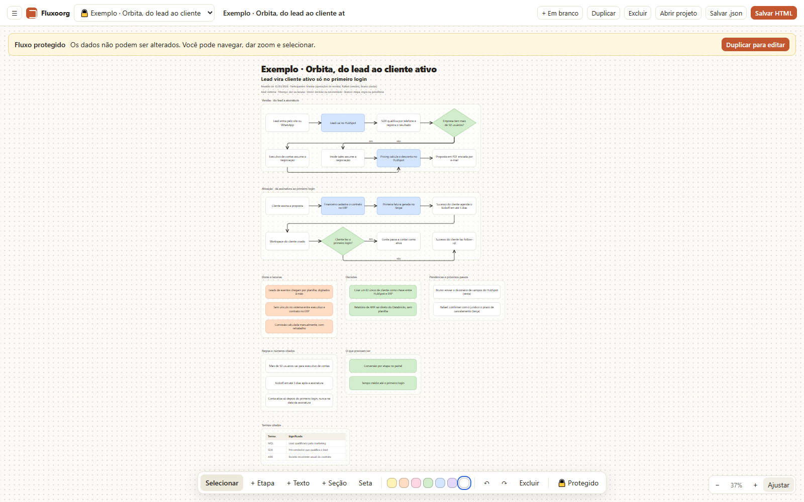

<div align="center">

# Fluxoorg

**Paste a meeting transcript. Get the process flow, decisions and action items on an editable board.**

A single HTML file · works offline · nothing leaves your computer · with a skill for Claude Code and Codex

[](https://github.com/carlos-dataengineer/fluxoorg/actions/workflows/ci.yml)
[](LICENSE)
[](docs/ARCHITECTURE.md)

[**Open the demo**](https://carlos-dataengineer.github.io/fluxoorg/) · [Install](#install) · [AI skill](#with-claude-code-or-codex) · [Português](README.md)



</div>

> The interface and the offline engine are in **Portuguese** today. The AI mode and the agent skill work with meetings in any language. Translations are on the roadmap. Contributions welcome!

## What it does

Fluxoorg reads a meeting conversation and draws what matters:

- the **process flow** in the order it happens, with **systems** highlighted;
- **process decisions** as diamonds with *yes*/*no* branches;
- **pains and gaps**, **decisions made**, **action items** with owner and due date;
- **rules and numbers** mentioned and a **glossary** of acronyms explained during the meeting;
- **sections by topic** when the conversation changes subject.

You review, edit, drag and save it as an HTML file that opens in any browser.

## Three ways to use it

| | Offline mode | AI mode | Agent skill |
|---|---|---|---|
| **How** | Language rules in the browser | Ready-made prompt for Claude, or direct API call with your key | Claude Code or Codex read the transcript and build the file |
| **Internet** | No | Yes | Only the agent |
| **Data leaves your machine** | Never | Only to the Anthropic API, if you choose | Only to the agent you already use |

Accepted inputs: `Name: text`, Microsoft Teams copy (`Name 00:01` + text), WebVTT (`.vtt`), SubRip (`.srt`) and plain text.

## Install

No install needed: the [demo](https://carlos-dataengineer.github.io/fluxoorg/) and [`app/index.html`](app/index.html) work on their own.
To get the tool on your computer **and** the skill in Claude Code and Codex:

```powershell
# Windows
irm https://raw.githubusercontent.com/carlos-dataengineer/fluxoorg/main/install.ps1 | iex
```
```bash
# macOS / Linux
curl -fsSL https://raw.githubusercontent.com/carlos-dataengineer/fluxoorg/main/install.sh | bash
```

The installer only copies files to `~/.claude/skills/fluxoorg`, `~/.codex/skills/fluxoorg`, `~/.agents/skills/fluxoorg` and `~/Fluxoorg/fluxoorg.html`.

As a Claude Code plugin:
```text
/plugin marketplace add carlos-dataengineer/fluxoorg
/plugin install fluxoorg@fluxoorg
```

## With Claude Code or Codex

> turn the transcript `meeting.vtt` into a flow with Fluxoorg

The agent writes a JSON *spec* following the [format](skills/fluxoorg/references/FORMATO.md) (schema: [`schema/fluxoorg.schema.json`](schema/fluxoorg.schema.json); English keys such as `title`, `flows`, `steps`, `links` are accepted), validates it and renders a ready HTML with [`render.py`](skills/fluxoorg/scripts/render.py). Nothing is published by default.

```bash
python skills/fluxoorg/scripts/render.py examples/orbita.spec.json -o orbita.html --open
```

## Privacy

Offline mode makes **no network requests**: no cookies, no `localStorage`, no analytics, no third-party scripts. AI mode sends the transcript only when you click **Gerar com IA**, only to `api.anthropic.com`, with your own key, which is never stored. See [docs/PRIVACY.md](docs/PRIVACY.md).

## Contributing

See [CONTRIBUTING.md](CONTRIBUTING.md) (in Portuguese; English issues and PRs are welcome too).

```bash
python scripts/build.py && python tests/validate_repo.py
python tests/test_engine.py && python tests/test_smoke.py   # needs Playwright
```

## License

[MIT](LICENSE)
