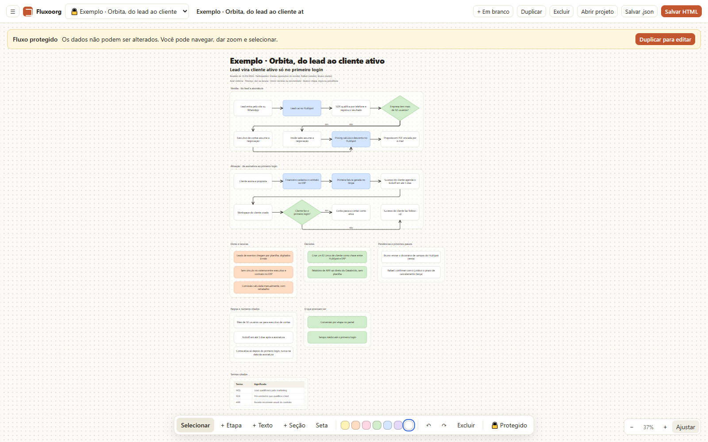
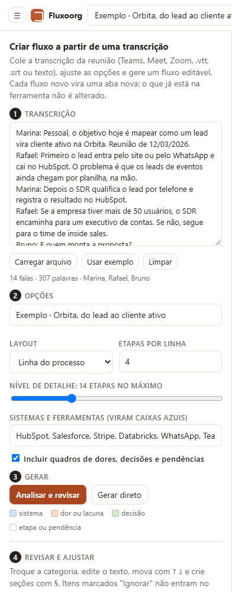
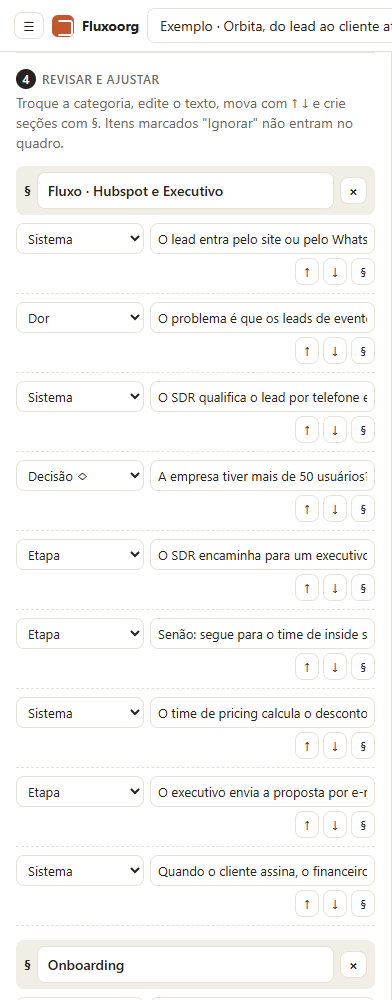
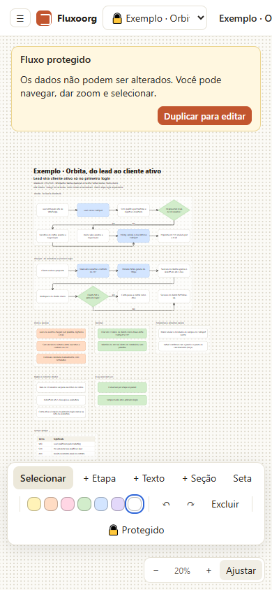
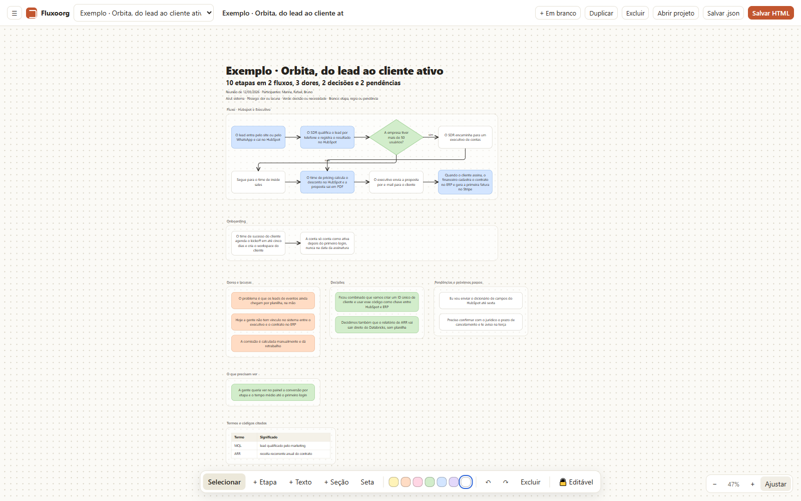
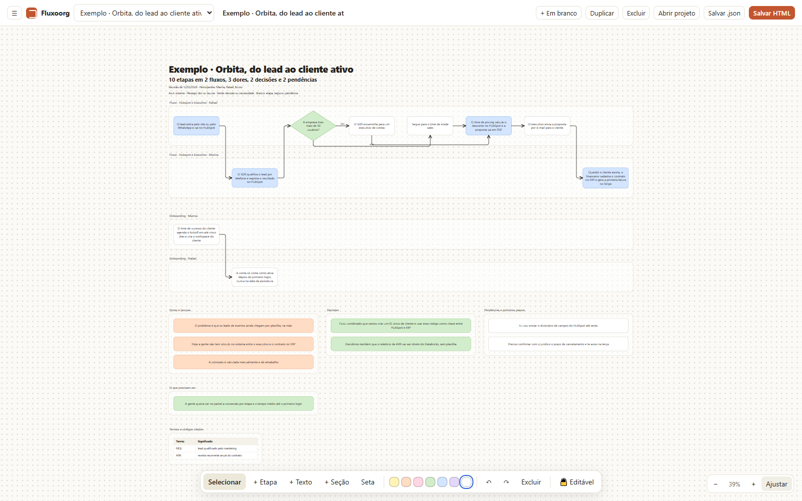
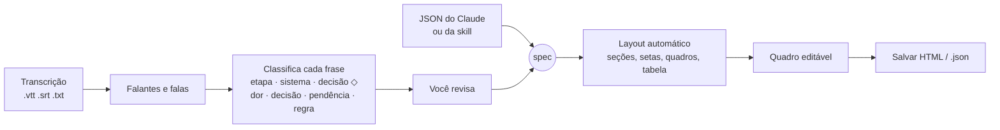

<div align="center">

# Fluxoorg

**Cole a transcrição da reunião. Receba o fluxo do processo, as decisões e as pendências num quadro editável.**

Um único arquivo HTML · funciona offline · nada sai do seu computador · com skill para Claude Code e Codex

[](https://github.com/carlos-dataengineer/fluxoorg/actions/workflows/ci.yml)
[](https://github.com/carlos-dataengineer/fluxoorg/releases)
[](LICENSE)
[](docs/ARCHITECTURE.md)
[](CONTRIBUTING.md)

[**Abrir a demo**](https://carlos-dataengineer.github.io/fluxoorg/) · [Instalar](#instalação) · [Como funciona](#como-funciona) · [Skill para IA](#com-claude-code-ou-codex) · [English](README.en.md)



</div>

## Por que existe

Toda reunião de levantamento termina igual: uma hora de gravação, uma transcrição de 20 páginas e ninguém com tempo de transformar aquilo em algo que dê para enxergar.
O Fluxoorg lê a conversa e devolve **o que importa, já desenhado**:

- 🧭 **o fluxo do processo**, na ordem em que ele acontece, com os **sistemas** em azul;
- ◇ **as decisões do processo** ("o cliente tem mais de 50 usuários?") com saídas *sim* e *não*;
- 🟧 **dores e lacunas** ("hoje é tudo na planilha");
- ✅ **decisões tomadas** e 📌 **pendências** com responsável e prazo;
- 📏 **regras e números citados** e uma **tabela de siglas** explicadas na reunião;
- 🗂️ **seções por assunto**, quando a conversa muda de tema.

Tudo vira um quadro que você **revisa, edita, arrasta e salva** como um HTML que abre em qualquer navegador.

## Em 30 segundos

1. Abra a [demo](https://carlos-dataengineer.github.io/fluxoorg/) (ou o arquivo `fluxoorg.html` depois de [instalar](#instalação)).
2. Cole a transcrição do Teams, Meet ou Zoom, ou carregue um `.vtt`, `.srt` ou `.txt`.
3. Clique em **Analisar e revisar**, ajuste o que quiser e depois em **Montar fluxo no quadro**.
4. Edite à vontade e clique em **Salvar HTML**: o arquivo baixado já leva o quadro dentro.

<table>
<tr>
<td width="33%"></td>
<td width="33%"></td>
<td width="33%"></td>
</tr>
<tr>
<td align="center"><sub>1. Cole a transcrição</sub></td>
<td align="center"><sub>2. Revise a classificação</sub></td>
<td align="center"><sub>Também no celular</sub></td>
</tr>
</table>

## Três jeitos de usar

| | Modo local | Modo IA | Skill no agente |
|---|---|---|---|
| **Como** | Regras de linguagem no navegador | Prompt pronto para o Claude, ou envio direto à API com a sua chave | Claude Code ou Codex leem a transcrição e montam o arquivo |
| **Precisa de internet** | Não | Sim | O agente sim; o arquivo não |
| **Precisão** | Boa para reuniões objetivas | Alta: reordena etapas, junta assuntos, entende contexto | Alta |
| **Dados saem do computador** | Nunca | Só para a API da Anthropic, se você escolher | Só para o agente que você já usa |

### Modo local (padrão)

Sem IA e sem rede. O motor lê as falas, separa frases, descarta perguntas e conversa solta e classifica cada frase por sinais da língua portuguesa ("primeiro", "depois", "se…", "ficou combinado", "vou enviar até sexta", "hoje é na mão"…). Você revisa tudo antes de desenhar.



### Modo IA (opcional)

Em **Modo IA**, clique em **Copiar prompt**, cole no Claude (ou em outra IA), copie o JSON da resposta e cole em **Colar JSON devolvido**. Ou informe sua chave da API e clique em **Gerar com IA**: a chave fica só na memória da página e não é salva.

### Raias por participante

Troque o layout para **Raias por participante** e cada pessoa (ou área, no modo IA) ganha a sua faixa.



## Instalação

Não precisa instalar nada para usar: a [demo](https://carlos-dataengineer.github.io/fluxoorg/) e o arquivo [`app/index.html`](app/index.html) funcionam sozinhos.
Para ter a ferramenta no computador **e** a skill no Claude Code e no Codex, rode um comando:

**Windows (PowerShell)**
```powershell
irm https://raw.githubusercontent.com/carlos-dataengineer/fluxoorg/main/install.ps1 | iex
```

**macOS e Linux**
```bash
curl -fsSL https://raw.githubusercontent.com/carlos-dataengineer/fluxoorg/main/install.sh | bash
```

O instalador só copia arquivos (leia antes, se quiser: [`install.ps1`](install.ps1), [`install.sh`](install.sh)):

| Para onde | O quê |
|---|---|
| `~/.claude/skills/fluxoorg` | Skill do Claude Code |
| `~/.codex/skills/fluxoorg` e `~/.agents/skills/fluxoorg` | Skill do Codex e de outros agentes |
| `~/Fluxoorg/fluxoorg.html` | A ferramenta, aberta no navegador ao final |

Opções: `-NoOpen`, `-SkipClaude`, `-SkipCodex`, `-Ref v1.0.0` (PowerShell) ou `--no-open`, `--skip-claude`, `--skip-codex`, `--ref v1.0.0` (bash).
Para remover: [`uninstall.ps1`](uninstall.ps1) ou [`uninstall.sh`](uninstall.sh).

**Como plugin do Claude Code:**
```text
/plugin marketplace add carlos-dataengineer/fluxoorg
/plugin install fluxoorg@fluxoorg
```

## Com Claude Code ou Codex

Depois de instalar, abra uma conversa nova e peça:

> transforme a transcrição `reuniao.vtt` em fluxo com o Fluxoorg

O agente lê a reunião, escreve uma *spec* JSON seguindo o [formato](skills/fluxoorg/references/FORMATO.md), valida e gera um HTML pronto com [`render.py`](skills/fluxoorg/scripts/render.py), na pasta `~/Fluxoorg/`. Várias reuniões de uma vez viram várias abas no mesmo arquivo. Por padrão **nada é publicado**: o arquivo fica só no seu computador.

Você também pode usar o script sem agente:

```bash
python skills/fluxoorg/scripts/render.py examples/orbita.spec.json -o orbita.html --open
```

## Como funciona



Detalhes do motor, do layout e da persistência em [docs/ARCHITECTURE.md](docs/ARCHITECTURE.md).

## Atalhos do quadro

| Ação | Como |
|---|---|
| Selecionar / mover | `V`, clique e arraste (seções levam o conteúdo junto) |
| Conectar duas caixas | `A`, clique na origem e no destino |
| Editar texto ou rótulo da seta | Duplo clique (`Ctrl+Enter` confirma, `Esc` cancela) |
| Várias seleções | `Shift` + clique |
| Apagar | `Del` |
| Desfazer / refazer | `Ctrl+Z` / `Ctrl+Y` |
| Zoom / mover a tela | `Ctrl` + rolagem / rolagem |
| Texto nas caixas | `**negrito**`, `*itálico*`, `` `código` ``, listas com `- ` |

## Formatos de transcrição aceitos

| Origem | Exemplo |
|---|---|
| Texto com nomes | `Marina: Primeiro o lead entra pelo site.` |
| Teams (cópia da transcrição) | `Marina Souza 00:01` numa linha e a fala na seguinte |
| WebVTT (`.vtt`) | `<v Marina Souza>Primeiro o lead…</v>` |
| SubRip (`.srt`) e texto sem nomes | Funciona; sem nomes, o layout por raias fica com uma raia só |

Exemplos fictícios em [`examples/`](examples).

## Privacidade

- O modo local **não faz nenhuma requisição de rede**. Sem cookies, sem `localStorage`, sem análise de uso, sem scripts de terceiros.
- O modo IA envia a transcrição **só** se você clicar em **Gerar com IA**, e só para `api.anthropic.com`, com a sua chave.
- O HTML salvo leva os fluxos dentro: guarde-o como guardaria a transcrição.

Mais em [docs/PRIVACY.md](docs/PRIVACY.md) e [SECURITY.md](SECURITY.md).

## Perguntas frequentes

**Funciona com reuniões em inglês?** O modo IA e a skill sim. O modo local foi calibrado para português; suporte a outras línguas está no roteiro.

**O fluxo saiu fora de ordem.** No modo local, a ordem é a da conversa: use ↑ ↓ na revisão. O modo IA e a skill reordenam pelo processo.

**Um nome virou falante sem ser pessoa.** Rótulos `Algo:` só viram falantes quando aparecem duas vezes ou mais. Se ainda assim acontecer, troque a categoria na revisão.

**Quero mudar as cores.** Selecione uma ou mais caixas e escolha a cor na barra inferior.

**O exemplo está protegido.** É de propósito: use **Duplicar para editar**.

## Roteiro

- [ ] Modo local em inglês e espanhol
- [ ] Exportar PNG e SVG do quadro
- [ ] Exportar para Mermaid e draw.io
- [ ] Mesclar várias reuniões do mesmo projeto num único fluxo
- [ ] Tema escuro

Ideias e votos nas [Discussions](https://github.com/carlos-dataengineer/fluxoorg/discussions).

## Contribuindo

Contribuições são muito bem-vindas: veja o [guia de contribuição](CONTRIBUTING.md). Em resumo:

```bash
python scripts/build.py            # junta src/ em app/index.html
python tests/validate_repo.py      # validações estáticas
python tests/test_engine.py        # motor de análise (Playwright)
python tests/test_smoke.py         # interface no navegador (Playwright)
```

Se o Fluxoorg te poupou uma tarde de ata, deixe uma ⭐: ajuda outras pessoas a encontrarem o projeto.

## Licença

[MIT](LICENSE). Use, modifique e distribua à vontade.
