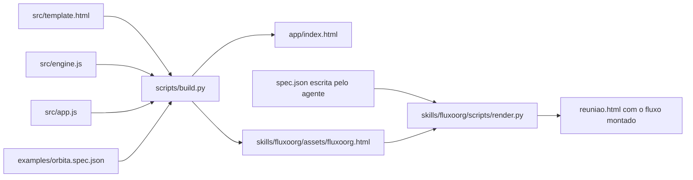
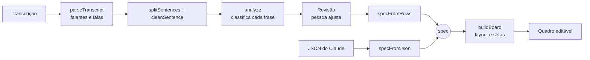

# Arquitetura

O Fluxoorg é um único arquivo HTML sem dependências. As fontes ficam separadas para serem fáceis de ler e testar; `scripts/build.py` junta tudo.

## Do texto ao quadro

### 1. `parseTranscript` (engine)
Lê `.vtt` (`<v Nome>`), `.srt`, o formato do Teams (`Nome 00:01` numa linha e a fala na seguinte) e `Nome: fala`.
Um rótulo `Algo:` só vira falante se aparecer **duas vezes ou mais**, para não confundir "Nota:" ou "Exemplo:" com pessoas.
Falas seguidas da mesma pessoa são unidas.

### 2. `analyze` (engine)
Cada frase passa por expressões regulares em português, nesta prioridade:

| Categoria | Sinais |
|---|---|
| Decisão tomada (`dec`) | "decidimos", "ficou combinado", "vamos usar/criar…" |
| Pendência (`pen`) | "vou enviar", "fica de", "até sexta", "a confirmar" |
| Dor (`pain`) | "problema", "na mão", "planilha", "não temos", "retrabalho" |
| Necessidade (`want`) | "queremos", "gostaria", "precisamos ver" |
| Regra (`rule`) | "sempre", "nunca", "só conta", prazos, `%`, `R$` |
| Etapa / sistema (`step` / `sys`) | ordem ("primeiro", "depois", "se…"), verbos de processo, nome de sistema da lista |

Perguntas (`?`) e conversa solta ("bom dia", "beleza") são descartadas. "Se X, Y" vira uma condição ◇ e uma etapa.
Frases como "Agora sobre o onboarding" abrem uma nova seção; seções com mais de 12 etapas são divididas onde o vocabulário muda.
Siglas definidas na fala ("ARR é a receita…") vão para a tabela de termos.
Um placar (`score`) escolhe as frases mais informativas até o limite do **nível de detalhe**, descartando quase-repetições (similaridade de Jaccard > 0,6).

### 3. Spec
`specFromRows` (modo local) e `specFromJson` (modo IA, skill) produzem a mesma estrutura: `flows[]` com `nodes` e `edges`, `panels[]` e `tables[]`. O formato público está em [`skills/fluxoorg/references/FORMATO.md`](../skills/fluxoorg/references/FORMATO.md).

### 4. `buildBoard` (app)
Calcula posições: linhas de N etapas ou raias por participante, altura de cada caixa medida com o texto real, setas ortogonais com cantos arredondados que contornam por baixo quando pulam etapas, quadros em grade de três colunas e tabelas com largura por conteúdo.

## Persistência

- **Salvar HTML** reescreve o conteúdo de `<script id="seed">` com todos os fluxos e esvazia `<script id="spec">`. O arquivo abre igual em qualquer navegador.
- **Salvar .json** exporta `{app:"fluxoorg", v:1, flows:[…]}`; **Abrir projeto** importa como abas novas.
- Na abertura: fluxos do `seed` → specs do `spec` (skill) → exemplo `demo` (só se não houver nada).

## Por que sem dependências

Um HTML que abre com dois cliques, funciona sem internet, pode ser enviado por e-mail e não quebra quando um CDN muda. O custo é escrever o layout à mão, o que é aceitável para este tipo de quadro.
